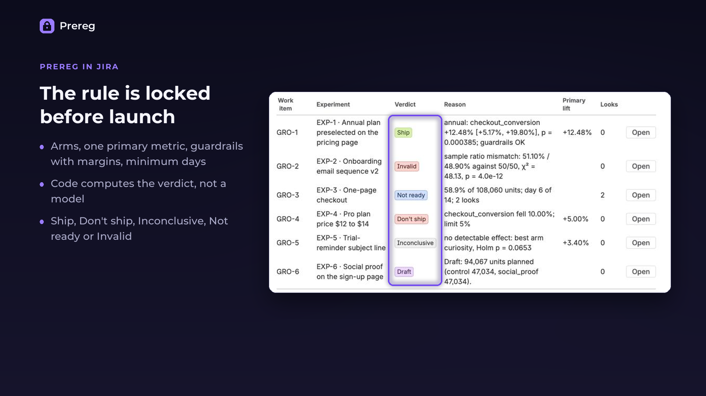
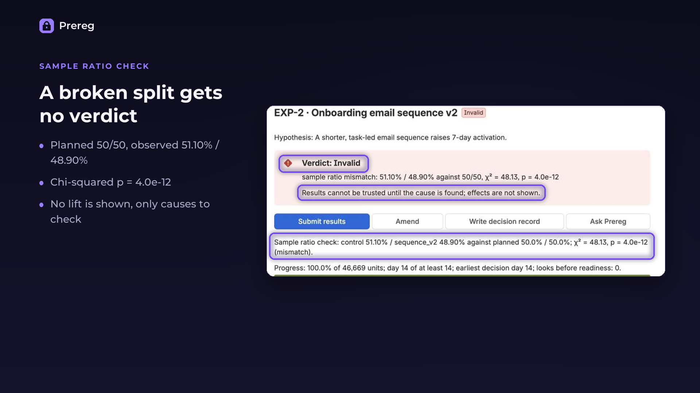
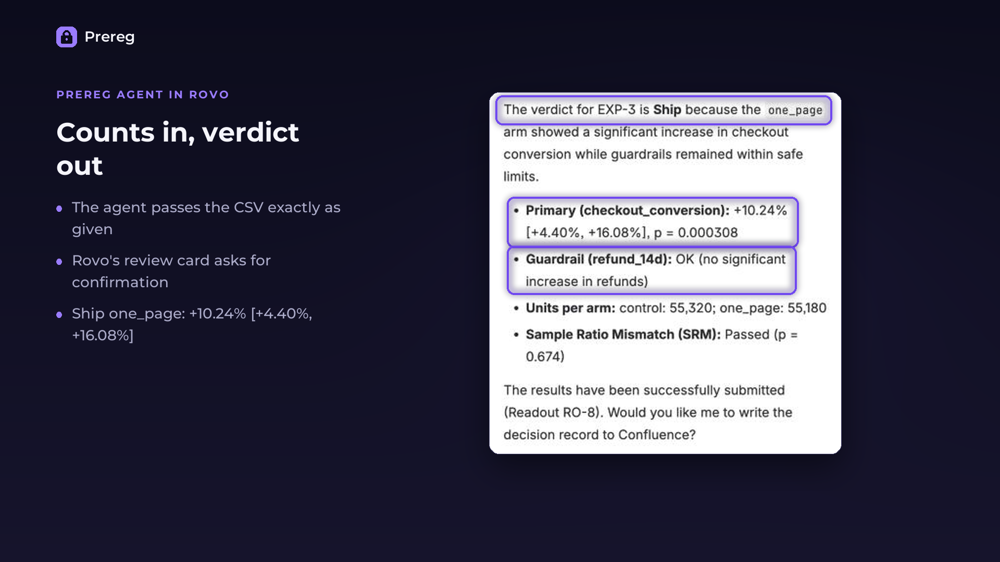
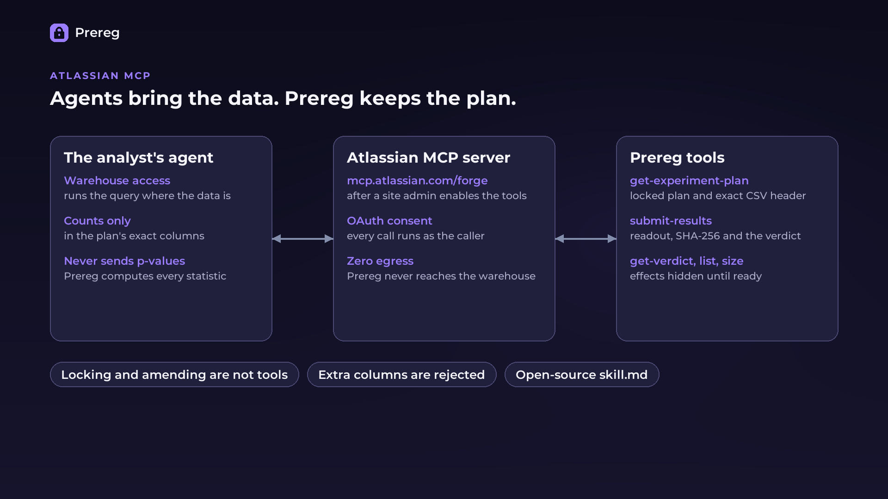

# Prereg

Lock an A/B test's decision rule before launch. Prereg computes the verdict in Jira, and AI analysts submit results over MCP without moving the goalposts. A Forge app for Jira (Confluence optional) with a Rovo agent and Atlassian MCP tools. Prereg's code, not a model, computes every statistic.

- Demo video (3:41): https://youtu.be/wPXx7mqsCeo
- Project page: https://devpost.com/software/prereg

## Why

Growth, marketing and pricing teams already plan experiments in Atlassian: Confluence has an "Experiment plan and results" template with a hypothesis, metrics and a free-text conclusion. Nothing checks that the conclusion follows from the data under the plan the team agreed. That matters because most ideas fail: at Bing, fewer than a third of ideas improved the metric they were designed to improve. Microsoft found a sample ratio mismatch, a broken split that invalidates the test, in about 6% of its A/B tests, and LinkedIn in about 10% of zoomed-in tests. Checking results before the planned sample size ("peeking") inflates false positives far above the nominal 5%. And AI agents now read out tests, and they can try metrics faster than any analyst.

## What it does

- **Lock the decision rule at launch.** On the experiment's Jira work item the team states the arms, one primary metric with its minimum detectable effect, guardrails with their margins, secondary metrics and the minimum duration. Prereg computes the sample size per arm. **Lock & launch** freezes plan v1 with a fingerprint. Later changes are amendments, labelled "after launch" and never used for the official verdict.
- **Accept results only as counts in the plan's columns.** A results CSV must have exactly `arm`, `units` and the plan's metric keys. An extra column is rejected and nothing is stored.
- **Compute the verdict in code**, with reasons:
  - **Invalid** when the split does not match the plan (chi-squared sample ratio check). No effects are shown at all. In the demo, a readout claiming +4.2% had a 51.10% / 48.90% split against 50/50 (p = 4.0e-12); with bot sign-ups removed, the "lift" became −0.15% [−2.48%, +2.19%]: **Inconclusive**.
  - **Not ready** before the planned sample and minimum days. Lifts, p-values and even directions stay hidden, in the UI and in every tool response, and each early look is counted.
  - **Don't ship** when a guardrail fails its non-inferiority test, even if the primary metric improved.
  - **Inconclusive** when there is no detectable effect, with Holm's correction across treatments.
  - **Ship** the winning arm when the primary metric is significant in the planned direction and every guardrail is OK.
- **AI analysts bring the data, not the conclusions.** Through Atlassian's MCP server an analyst's own agent reads the locked plan (`get-experiment-plan` returns the exact CSV header), runs the query where the data is, and submits counts (`submit-results`). It cannot pick metrics or thresholds after the fact.
- **The Prereg agent in Rovo** quotes the computed verdict, explains an invalid split, submits a pasted CSV unchanged after the person confirms Rovo's review card, drafts plans and writes the decision record.
- **Jira and Confluence fit.** An indexed issue property (`preregVerdict = invalid` in JQL), a glance, and a decision record page with plan v1, the numbers, looks and amendments.

## Screenshots









## How it is built

| Path | What it is |
|---|---|
| `manifest.yml` | Forge modules: `jira:globalPage`, `jira:issuePanel`, `jira:issueGlance`, `jira:entityProperty`, a `trigger` on work item updates, `rovo:agent` (10 actions), `rovo:skill`, `rovo:mcp` (5 tools) |
| `src/engine/` | Pure statistics, no Forge imports: chi-squared sample ratio check (regularized incomplete gamma), two-sample z-tests with a delta-method interval for the relative lift, Holm–Bonferroni, one-sided non-inferiority tests, the early harm stop, readiness and sample size, the strict CSV contract |
| `src/services/` | Drafting, locking and amending plans, readouts, verdicts, the portfolio and the decision record |
| `src/actions/` | Rovo actions |
| `src/platform/`, `src/store/` | Jira and Confluence REST calls, Forge storage |
| `src/frontend/` | UI Kit global page, issue panel and result tables |
| `skills/` | The Rovo skill and an open `SKILL.md` for third-party agents |
| `research/` | The Python standard-library oracle, written before any app code |
| `test/` | 13 test groups |

**Locked means locked.** The plan's canonical JSON is hashed with SHA-256 at launch and the verdict always uses version 1. Because a language model relays the CSV, every submitted CSV is hashed and the hash shown; in our test, the readout created through the Rovo agent had exactly the SHA-256 of the CSV we pasted.

External MCP clients connect to `https://mcp.atlassian.com/forge/<your-app-id>` after a site admin turns on Prereg's tools for external clients and the user approves the OAuth consent. Every call runs with the caller's own Jira permissions.

Prereg makes no external calls. It stores experiments, plan versions and readouts (counts, a source label and a note) in Forge storage, and one issue property per experiment. It stores no account IDs, names or email addresses.

## Tests

```bash
npm test
```

13 test groups with Node's built-in runner (Node.js 22 or later; no install needed). The golden tests compare every number with the independent Python oracle in `research/` at a relative error of 1e-6, plus edge cases for the CSV contract, readiness boundaries, Holm, guardrail boundaries and sample size. A dedicated test checks that a Not ready or Invalid readout's tool output contains no effect statistics.

## Deploy your own copy

You need Node.js 22 or later, the [Forge CLI](https://developer.atlassian.com/platform/forge/getting-started/) and a Jira site where you are an admin (a free developer site works).

```bash
npm install
forge register
forge deploy -e development
forge install -e development --site your-site.atlassian.net --product jira
```

`forge register` writes your own app ID into `manifest.yml`. Then follow [docs/WALKTHROUGH.md](docs/WALKTHROUGH.md).

## Limitations

- Fixed-horizon tests only. Sequential tests (always-valid p-values) are planned.
- The Rovo agent sometimes does its own arithmetic (it once reported 104% progress); the verdict itself always comes from code.

## Sources

- Atlassian, Experiment plan and results template: https://www.atlassian.com/software/confluence/templates/experiment-plan-and-results
- Bing, Large-scale experimentation at Bing (2013): https://blogs.bing.com/search-quality-insights/2013/08/08/large-scale-experimentation-at-bing
- Microsoft Experimentation Platform, Diagnosing sample ratio mismatch in A/B testing: https://www.microsoft.com/en-us/research/articles/diagnosing-sample-ratio-mismatch-in-a-b-testing/
- Johari, Pekelis, Walsh, Always Valid Inference: https://arxiv.org/abs/1512.04922
- Spotify, Risk-aware product decisions in A/B tests with multiple metrics: https://engineering.atspotify.com/2024/3/risk-aware-product-decisions-in-a-b-tests-with-multiple-metrics

## License

Apache-2.0. Built for Codegeist 2026. Most of the code, tests and documentation were written with Claude Code (Anthropic's AI coding agent). The demo data is fictional and the narration is synthetic.
